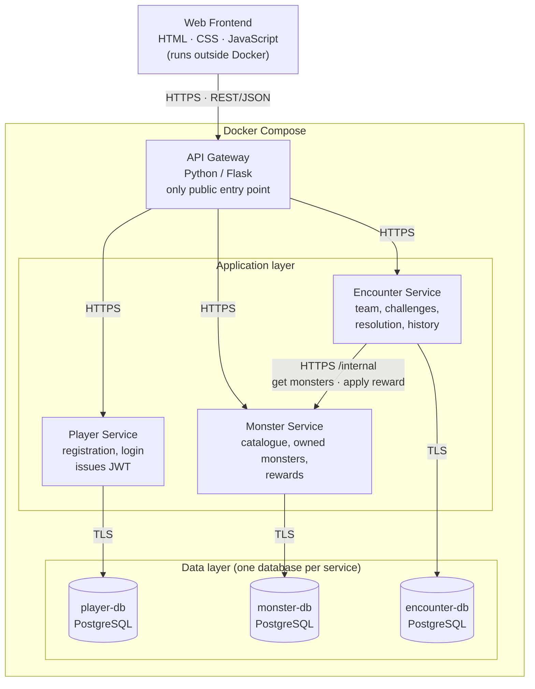

# Monster Tamers

# Group ETHE
Elisa	Angelinelli - e.angelinelli@studenti.unipi.it
Tancredi	Cappello - t.cappello@studenti.unipi.it
Hatem Magdy Mohamed Ahmed	Elashmawy h.elashmawy@studenti.unipi.it
Elena	Palandri - e.palandri1@studenti.unipi.it

Monster Tamers is a web game built as microservices for the Advanced Software Engineering course. Players collect monsters, build a team of three and take on challenges against wild monsters: in each encounter they attack, try to capture the wild monster or escape.


# Architecture diagram





## OpenAPI specifications

The project exposes an OpenAPI 3.0 specification for each HTTP-facing
service:

- [Gateway API](gateway/openapi.yaml)
- [Player Service API](player_service/openapi.yaml)
- [Monster Service API](monster_service/openapi.yaml)
- [Encounter Service API](encounter_service/openapi.yaml)

These specifications describe the public routes, request and response
schemas, authentication requirements, and internal service-to-service
operations. They can be imported into Swagger UI, Postman, Bruno, or another
OpenAPI-compatible tool.

## Implementation status

Implemented:

- Player Service registration, login, RS256 JWT issuance, and PostgreSQL persistence (`player-db`);
- Monster Service catalogue, player collections, image assets, and idempotent rewards (`monster-db`);
- Encounter Service teams, challenges, encounter resolution, history, and reward delivery (`encounter-db`);
- API Gateway as the single public HTTPS entry point with rate limiting and `/assets/monsters/` proxying;
- Mutual/CA-verified HTTPS certificates (`tls-init`) and TLS-enforced PostgreSQL databases;
- Non-root standalone frontend container communicating exclusively with the API Gateway;
- Unit, component, security, and Bruno API tests for all implemented flows.

## Get Started

### Prerequisites

- Docker Desktop with Docker Compose v2 (no local Python or Node.js installation is required to run the containers).
- Python 3.12+ (only to run Python unit tests locally).
- Bruno 4.3 app or `@usebruno/cli@4.3.0` (only to run the Bruno API collections locally).

### Quick Start Shortcut (Development Only)

> **Disclaimer:** This shortcut does not respect production security principles. For the sake of simplicity and velocity in local development, it automatically generates local `.env` secrets on the host, starts the backend stack, and builds and runs the standalone frontend container.

From the repository root:

```powershell
# Windows (PowerShell)
.\start-dev.ps1
```

```bash
# Linux / macOS
chmod +x start-dev.sh
./start-dev.sh
```

To stop the shortcut stack (`-ResetVolumes` / `--reset` also removes persisted data and certificates):

```powershell
.\start-dev.ps1 -Stop
```

```bash
./start-dev.sh --stop
```

### 1. Configure environment secrets

Passwords and internal secrets are never committed. From the repository root, create `.env` from the template:

```powershell
# PowerShell
Copy-Item .env.example .env
```

```bash
# Linux/macOS
cp .env.example .env
```

Open `.env` and replace every `change-me` placeholder (`PLAYER_DB_ADMIN_PASSWORD`, `PLAYER_DB_PASSWORD`, `MONSTER_DB_ADMIN_PASSWORD`, `MONSTER_DB_PASSWORD`, `ENCOUNTER_DB_ADMIN_PASSWORD`, `ENCOUNTER_DB_PASSWORD`, `INTERNAL_SERVICE_SECRET`). Use only letters, digits, `-`, and `_` (database passwords are embedded in connection URLs).

### 2. Build and run the backend stack

Run from the repository root (if your terminal is inside a service subfolder, run `Set-Location ..` or `cd ..` first so Docker Compose picks up the root `docker-compose.yaml` and `.env`):

```powershell
docker compose up --build -d --wait
docker compose ps
```

Wait until all services report `running` or `healthy`:

| Component | URL | Visibility |
|---|---|---|
| API Gateway | `https://localhost:5005` | Public entry point |
| Player Service | `https://player-service:5001` | Internal Docker network only |
| Monster Service | `https://monster-service:5002` | Internal Docker network only |
| Encounter Service | `https://encounter-service:5003` | Internal Docker network only |

To stop the backend while keeping database volumes and generated certificates:

```powershell
docker compose down
```

To stop it and delete all persisted data and certificates:

```powershell
docker compose down -v
```

### 3. Build and run the standalone frontend container

The frontend runs in a separate, non-root Docker container outside the backend Compose network and communicates exclusively with the API Gateway on `https://localhost:5005`:

```powershell
docker build -t monster-tamer-frontend ./frontend_service
docker run -d --name monster-tamer-frontend -p 127.0.0.1:8080:8080 monster-tamer-frontend
```

Open `http://localhost:8080` in your browser. Because the API Gateway uses a local CA-signed certificate generated by `tls-init`, open `https://127.0.0.1:5005/health` in your browser first and accept the local development certificate if prompted.

To stop and remove the frontend container:

```powershell
docker rm -f monster-tamer-frontend
```

### Run the Encounter component stack

For a complete runnable Encounter workflow, use the component Compose file. It
starts the real Encounter Service and database plus Monster and Player stubs:

```powershell
docker compose -f compose.encounter.yaml up --build -d --wait
docker compose -f compose.encounter.yaml ps
```

The Encounter API is available at `https://localhost:5003`; `GET /health`
does not require authentication. To stop the component stack:

```powershell
docker compose -f compose.encounter.yaml down
```

Add `-v` to the last command to also delete its databases, certificates, and
other volumes. See the [Bruno API test instructions](tests/bruno/README.md)
for the component-stack test workflow.

## Testing instructions

### Unit tests

Run the unit tests for each service:

```powershell
# Player Service
cd player_service
python -m pytest -q
cd ..

# Monster Service
.\.venv\Scripts\python.exe -m pytest monster_service\tests -q

# Gateway
.\.venv\Scripts\python.exe -m pytest gateway\tests -q

# Encounter Service
cd encounter_service
python -m pytest -q
cd ..
```

### Bruno API tests

Follow [tests/bruno/README.md](tests/bruno/README.md) to start the component
stack, configure Bruno's custom CA certificate, and run the collections.
With the Bruno CLI installed:

```bash
cd tests/bruno
bru run encounter encounter-stub encounter-security \
  --env encounter-component --cacert ca.pem
```

An exit code of zero means that all selected API tests passed.

### Bruno tests of the Player Service

```
docker compose -f compose.player.yaml up --build -d --wait
docker compose -f compose.player.yaml cp player-service:/certs/ca.pem tests_player/bruno/ca.pem
```

The services use HTTPS with certificates from our own development authority, so
Bruno has to trust it: in Bruno, open Preferences > General, turn on "Use custom
CA Certificate" and choose `tests_player/bruno/ca.pem`. `ca.pem` is the authority's
public certificate, not a secret. It is not committed because a new one is made
after every `down -v`, so copy it again then.

Then open `tests_player/bruno` as a collection and run it with the Runner, or from
the terminal (with Node: `npm install -g @usebruno/cli@4.3.0`):

```
cd tests_player/bruno
bru run health account login --cacert ca.pem
```

Exit code 0 means every test passed. To stop:

```
docker compose -f compose.player.yaml down -v
```


## Additional information

- The API Gateway is the only intended public entry point.
- Player requests use JWTs issued by the Player Service.
- Internal service requests use HTTPS and a shared internal secret; the
  frontend must not call internal endpoints directly.
- Each service owns its database and schema. Cross-service relationships use
  service APIs rather than database foreign keys.
- The Encounter Service retries transient reward failures, while the Monster
  Service makes reward application idempotent by encounter ID.
- The frontend runs in a separate standalone Docker container outside the backend Compose network and communicates exclusively with the API Gateway on `https://localhost:5005`.

## Documents
- User stories (Google Sheet): https://docs.google.com/spreadsheets/d/1n1LCP2W7xMwLvVTNbPtSIBRUSwD_GZDaspnIldx8m-4/edit?usp=sharing
- The report (Google Doc): https://docs.google.com/document/d/15P4AK-pznGCsa-_O73v8gIAjkfgWTypQP4pjskGHUH4/edit?tab=t.0
- Presentation: https://docs.google.com/presentation/d/1hwFVqbLTSIAy_W3j63UvVDcWr2Wxn_53_uNvN8ClWSE/edit?slide=id.p#slide=id.p
- Architecture and design decisions: [docs/architecture.md](docs/architecture.md)

## Services

| Folder | What it is | Owner |
|---|---|---|
| `gateway/` | API gateway, the only entry point from outside | Elisa |
| `player_service/` | Player Service: accounts, login, login tokens | Elisa |
| `monster_service/` | Monster Service: catalogue, players' monsters, rewards | Elena |
| `encounter_service/` | Encounter Service: team, challenges, encounters | Hatem |
| `frontend_service/` | Web frontend | Tancredi |

Shared parts:

| Folder | What it is |
|---|---|
| `tls_init/` | Makes the HTTPS certificates of every service and the key pair for login tokens. It runs at every `docker compose up` and keeps what already exists. |
| `monster_stub/`, `player_stub/` | Stand-ins for the Monster and Player services in component tests |
| `tests/bruno/` | The Bruno API tests, with a folder per service and per stub |
| `tests_player/bruno/` | The Bruno API tests on player service, with a folder per service|
