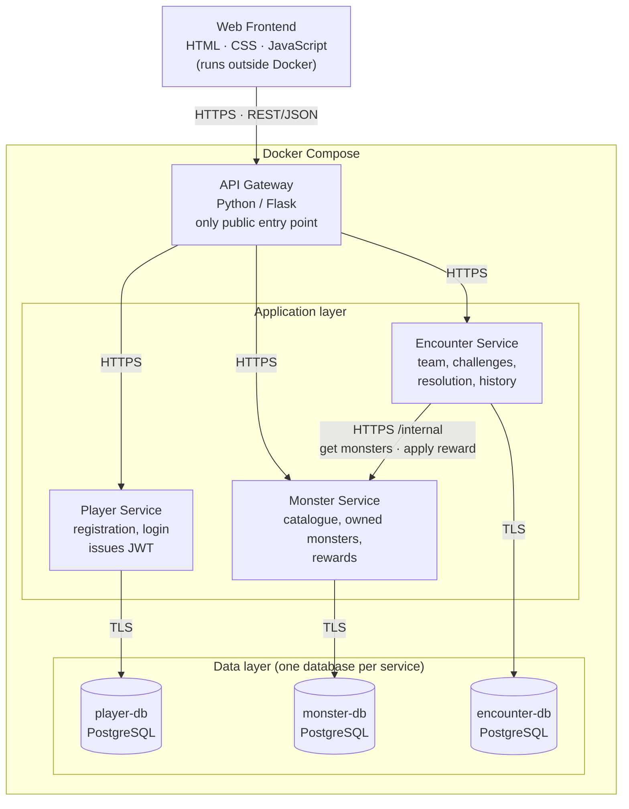

# Monster Tamers

## Group
Elisa Angelinelli, Tancredi Cappello, Hatem Magdy Mohamed Ahmed Elashmawy, Elena Palandri


## Architecture diagram



## OpenAPI specifications

The project exposes an OpenAPI 3.0 specification for each HTTP-facing
service:

- [Gateway API](gateway/openapi.yaml)
- [Player Service API](player_service/openapi.yaml)
- [Monster Service API](monster_service/openapi.yaml)
- [Encounter Service API](encounter_service/openapi.yaml)

These specifications describe the public routes, request and response
schemas, authentication requirements, and internal service-to-service
operations. They can be imported into Swagger UI, Postman, Bruno, or another
OpenAPI-compatible tool.

## Implementation status

Implemented:

- Player Service registration, login, JWT issuance, and player data;
- Monster Service catalogue, player collections, image assets, and rewards;
- Encounter Service teams, challenges, encounter resolution, history, and
  reward delivery;
- API Gateway as the public entry point;
- HTTPS certificates for service-to-service communication;
- PostgreSQL persistence with one database per service;
- Front-end skeleton with working registration, login and team management
- Unit tests for the encounter service

To be done:

- Proper JWT verification on service to service communication
- TLS from front-end to gateway
- Communication from the encounter service to the monster service
- Front-end connection with the gateway for playing encounters and browsing history
- Fix some failing unit tests (see below)
- Unit tests for the monster and player service
- Component, security and Bruno API tests
- (Eventually) user stories with green priority level

## Running instructions

### Prerequisites

Install Docker Desktop with Docker Compose v2 and make sure Docker is running.
The frontend is served by Nginx; no separate Python or Node.js installation is
required to run the services.

From the repository root, create the local environment file:

```powershell
Copy-Item .env.example .env
```
or
```
cp .env.example .env
```

Open `.env` and replace `change-me` with local values for all three variables.
Use only letters, digits, `-`, and `_` in the passwords and shared secret. The
file is ignored by Git and must never be committed.

### Start the current root stack

The root Compose file starts the TLS initializer, Player Service and its
database, Encounter Service and its database, and API Gateway:

```powershell
docker-compose build --no-cache
docker compose up
```

Then on a separate shell, run the frontend container:
```powershell
cd frontend_service
docker compose up
```

When all the containers are running, visit http://localhost:8000/ to access the frontend.

## Testing instructions

#### Encounter Service unit tests

Run the following for checking unit tests of the Encounter Service

```bash
cd encounter_service
python3 -m venv .venv
source .venv/bin/activate          # Windows: .venv\Scripts\activate
pip install -r requirements-dev.txt
python -m pytest
```

The current state is 13 failed, 127 passed.

#### Monster Service unit tests

To be implemented.

#### Player Service unit tests

To be implemented.


## Documents
- User stories (Google Sheet): https://docs.google.com/spreadsheets/d/1n1LCP2W7xMwLvVTNbPtSIBRUSwD_GZDaspnIldx8m-4/edit?usp=sharing
- The report (Google Doc): https://docs.google.com/document/d/15P4AK-pznGCsa-_O73v8gIAjkfgWTypQP4pjskGHUH4/edit?tab=t.0
- Presentation: https://docs.google.com/presentation/d/1hwFVqbLTSIAy_W3j63UvVDcWr2Wxn_53_uNvN8ClWSE/edit?slide=id.p#slide=id.p
- Architecture and design decisions: [docs/architecture.md](docs/architecture.md)
