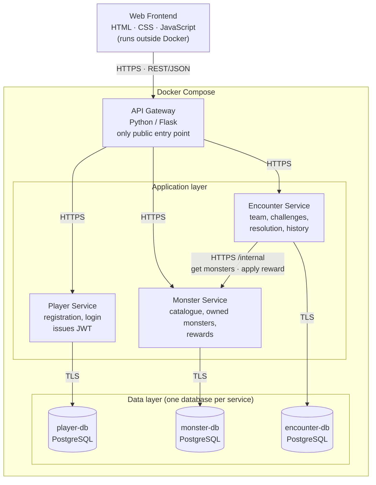

# Monster Tamers

# Group ETHE
Elisa	Angelinelli - e.angelinelli@studenti.unipi.it
Tancredi	Cappello - t.cappello@studenti.unipi.it
Hatem Magdy Mohamed Ahmed	Elashmawy h.elashmawy@studenti.unipi.it
Elena	Palandri - e.palandri1@studenti.unipi.it

Monster Tamers is a web game built as microservices for the Advanced Software Engineering course. Players collect monsters, build a team of three and take on challenges against wild monsters: in each encounter they attack, try to capture the wild monster or escape.


# Architecture diagram





## OpenAPI specifications

The project exposes an OpenAPI 3.0 specification for each HTTP-facing
service:

- [Gateway API](gateway/openapi.yaml)
- [Player Service API](player_service/openapi.yaml)
- [Monster Service API](monster_service/openapi.yaml)
- [Encounter Service API](encounter_service/openapi.yaml)

These specifications describe the public routes, request and response
schemas, authentication requirements, and internal service-to-service
operations. They can be imported into Swagger UI, Postman, Bruno, or another
OpenAPI-compatible tool.

## Implementation status

Implemented:

- Player Service registration, login, JWT issuance, and player data;
- Monster Service catalogue, player collections, image assets, and rewards;
- Encounter Service teams, challenges, encounter resolution, history, and
  reward delivery;
- API Gateway as the public entry point;
- HTTPS certificates and service-to-service communication;
- PostgreSQL persistence with one database per service;
- unit, component, security, and Bruno API tests for the implemented flows.

In progress:

- integration of the complete production stack, including the web frontend;
- final end-to-end deployment through the root Docker Compose configuration.

## Running instructions

### Prerequisites

Install Docker Desktop with Docker Compose v2 and make sure Docker is running.
The frontend is served by Nginx; no separate Python or Node.js installation is
required to run the services.

From the repository root, create the local environment file:

```powershell
Copy-Item .env.example .env
```

Open `.env` and replace `change-me` with local values for all three variables.
Use only letters, digits, `-`, and `_` in the passwords and shared secret. The
file is ignored by Git and must never be committed.

### Start the current root stack

The root Compose file starts the TLS initializer, Player Service and its
database, Encounter Service and its database, API Gateway, and frontend:

```powershell
docker compose up --build -d --wait
docker compose ps
```

Wait until the services show `running` or `healthy`. The services are available
at:

| Component | URL |
|---|---|
| Frontend | http://localhost:8080 |
| API Gateway | https://localhost:5005 |
| Player Service (direct local access) | https://localhost:5001 |
| Encounter Service (internal; not published by the root stack) | https://encounter-service:5003 |

The HTTPS endpoints use certificates generated by `tls-init`, so a browser or
client may show a certificate warning for local development. The gateway is
the intended entry point for API requests; the frontend is currently a static
file server and does not proxy requests to the gateway.

The current root Compose file does not include the real Monster Service. As a
result, catalogue, collection, and reward flows are not fully connected when
using only `docker compose up`; the Encounter component stack below uses
stubs for those dependencies. The [Monster Service README](monster_service/README.md)
contains its standalone instructions.

To stop the root stack while keeping databases, certificates, and other
volumes:

```powershell
docker compose down
```

To stop it and delete all persisted data and generated certificates:

```powershell
docker compose down -v
```

### Run the Encounter component stack

For a complete runnable Encounter workflow, use the component Compose file. It
starts the real Encounter Service and database plus Monster and Player stubs:

```powershell
docker compose -f compose.encounter.yaml up --build -d --wait
docker compose -f compose.encounter.yaml ps
```

The Encounter API is available at `https://localhost:5003`; `GET /health`
does not require authentication. To stop the component stack:

```powershell
docker compose -f compose.encounter.yaml down
```

Add `-v` to the last command to also delete its databases, certificates, and
other volumes. See the [Bruno API test instructions](tests/bruno/README.md)
for the component-stack test workflow.

## Testing instructions

### Encounter Service unit tests

```bash
cd encounter_service
python3 -m venv .venv
source .venv/bin/activate          # Windows: .venv\Scripts\activate
pip install -r requirements-dev.txt
python -m pytest
```

The Monster Service tests can be run from the repository root with:

```bash
pytest monster_service/tests -q
```

### Bruno API tests

Follow [tests/bruno/README.md](tests/bruno/README.md) to start the component
stack, configure Bruno's custom CA certificate, and run the collections.
With the Bruno CLI installed:

```bash
cd tests/bruno
bru run encounter encounter-stub encounter-security \
  --env encounter-component --cacert ca.pem
```

An exit code of zero means that all selected API tests passed.

### Bruno tests of the Player Service

```
docker compose -f compose.player.yaml up --build -d --wait
docker compose -f compose.player.yaml cp player-service:/certs/ca.pem tests_player/bruno/ca.pem
```

The services use HTTPS with certificates from our own development authority, so
Bruno has to trust it: in Bruno, open Preferences > General, turn on "Use custom
CA Certificate" and choose `tests_player/bruno/ca.pem`. `ca.pem` is the authority's
public certificate, not a secret. It is not committed because a new one is made
after every `down -v`, so copy it again then.

Then open `tests_player/bruno` as a collection and run it with the Runner, or from
the terminal (with Node: `npm install -g @usebruno/cli@4.3.0`):

```
cd tests_player/bruno
bru run health account login --cacert ca.pem
```

Exit code 0 means every test passed. To stop:

```
docker compose -f compose.player.yaml down -v
```


## Additional information

- The API Gateway is the only intended public entry point.
- Player requests use JWTs issued by the Player Service.
- Internal service requests use HTTPS and a shared internal secret; the
  frontend must not call internal endpoints directly.
- Each service owns its database and schema. Cross-service relationships use
  service APIs rather than database foreign keys.
- The Encounter Service retries transient reward failures, while the Monster
  Service makes reward application idempotent by encounter ID.
- The frontend is not yet included in the repository; the current workflows
  can be exercised through the service APIs and Bruno collections.

## Documents
- User stories (Google Sheet): https://docs.google.com/spreadsheets/d/1n1LCP2W7xMwLvVTNbPtSIBRUSwD_GZDaspnIldx8m-4/edit?usp=sharing
- The report (Google Doc): https://docs.google.com/document/d/15P4AK-pznGCsa-_O73v8gIAjkfgWTypQP4pjskGHUH4/edit?tab=t.0
- Presentation: https://docs.google.com/presentation/d/1hwFVqbLTSIAy_W3j63UvVDcWr2Wxn_53_uNvN8ClWSE/edit?slide=id.p#slide=id.p
- Architecture and design decisions: [docs/architecture.md](docs/architecture.md)

## Services

| Folder | What it is | Owner |
|---|---|---|
| `gateway/` | API gateway, the only entry point from outside | Elisa |
| `player_service/` | Player Service: accounts, login, login tokens | Elisa |
| `monster_service/` | Monster Service: catalogue, players' monsters, rewards | Elena |
| `encounter_service/` | Encounter Service: team, challenges, encounters | Hatem |
| `frontend_service/` | Web frontend | Tancredi |

Shared parts:

| Folder | What it is |
|---|---|
| `tls_init/` | Makes the HTTPS certificates of every service and the key pair for login tokens. It runs at every `docker compose up` and keeps what already exists. |
| `monster_stub/`, `player_stub/` | Stand-ins for the Monster and Player services in component tests |
| `tests/bruno/` | The Bruno API tests, with a folder per service and per stub |
| `tests_player/bruno/` | The Bruno API tests on player service, with a folder per service|

## Get started

### What you need
- Docker Desktop, with Docker Compose v2
- Python 3.12 or newer, only to run the unit tests
- Bruno 4.3 (the app, or the CLI with Node), only to run the API tests

### Secrets
Passwords and secrets are never committed. Copy the example file and set your own values, using only letters, digits, `-` and `_`:
```
cp .env.example .env
```

### Run the Encounter Service
It starts with its own database and with stubs of the Monster and Player services:
```
docker compose -f compose.encounter.yaml up --build -d --wait
docker compose -f compose.encounter.yaml ps
```
It answers on https://localhost:5003, where `GET /health` needs no login. The API is described in [encounter_service/openapi.yaml](encounter_service/openapi.yaml). To stop it:
```
docker compose -f compose.encounter.yaml down       # add -v to also delete the data and certificates
```

### Unit tests of the Encounter Service
```
cd encounter_service
python3 -m venv .venv
source .venv/bin/activate          # on Windows: .venv\Scripts\activate
pip install -r requirements-dev.txt
python -m pytest
```

### API tests with Bruno
See [tests/bruno/README.md](tests/bruno/README.md).

### How to start
Run the backend with `docker compose up`, and then run the front-end with
```
cd frontend_service
docker compose up
```
Visit localhost:8080/ to access the application.
