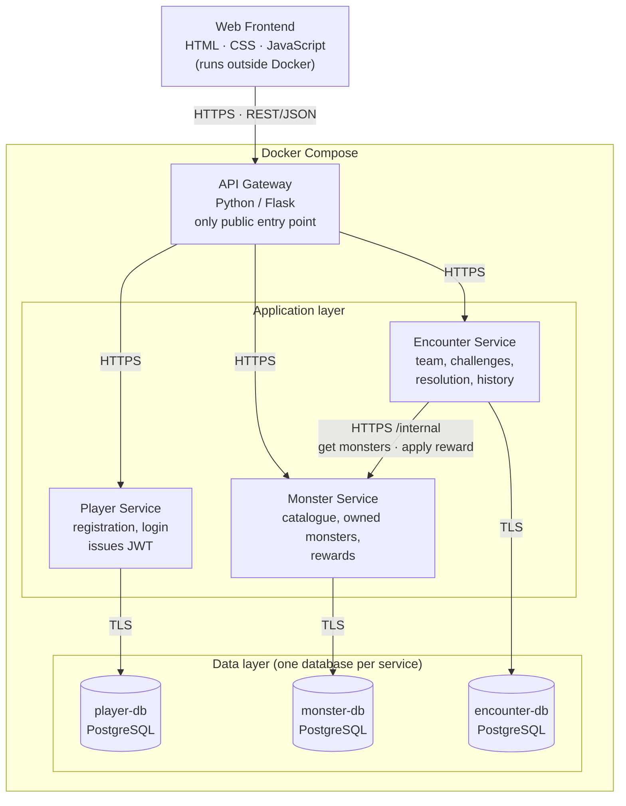

# Monster Tamers

# Group ETHE
Elisa	Angelinelli - e.angelinelli@studenti.unipi.it
Tancredi	Cappello - t.cappello@studenti.unipi.it
Hatem Magdy Mohamed Ahmed	Elashmawy h.elashmawy@studenti.unipi.it
Elena	Palandri - e.palandri1@studenti.unipi.it

Monster Tamers is a web game built as microservices for the Advanced Software Engineering course. Players collect monsters, build a team of three and take on challenges against wild monsters: in each encounter they attack, try to capture the wild monster or escape.


# Architecture diagram





## OpenAPI specifications

The project exposes an OpenAPI 3.0 specification for each HTTP-facing
service:

- [Gateway API](gateway/openapi.yaml)
- [Player Service API](player_service/openapi.yaml)
- [Monster Service API](monster_service/openapi.yaml)
- [Encounter Service API](encounter_service/openapi.yaml)

These specifications describe the public routes, request and response
schemas, authentication requirements, and internal service-to-service
operations. They can be imported into Swagger UI, Postman, Bruno, or another
OpenAPI-compatible tool.

## Implementation status

Implemented:

- Player Service registration, login, JWT issuance, and player data;
- Monster Service catalogue, player collections, image assets, and rewards;
- Encounter Service teams, challenges, encounter resolution, history, and
  reward delivery;
- API Gateway as the public entry point;
- HTTPS certificates and service-to-service communication;
- PostgreSQL persistence with one database per service;
- unit, component, security, and Bruno API tests for the implemented flows.

In progress:

- integration of the complete production stack, including the web frontend;
- final end-to-end deployment through the root Docker Compose configuration.

## Running instructions

### Encounter component stack

The currently documented runnable stack starts the Encounter Service together
with its Monster and Player stubs:

```bash
docker compose -f compose.encounter.yaml up --build -d --wait
docker compose -f compose.encounter.yaml ps
```

It is available at `https://localhost:5003`. To stop it:

```bash
docker compose -f compose.encounter.yaml down -v
```

See the service-specific READMEs for running an individual service, including
the [Monster Service instructions](monster_service/README.md).

### Prerequisites and secrets

Install Docker Desktop with Docker Compose v2. Copy the example environment
file and set local values before starting a stack:

```bash
cp .env.example .env
```

The project uses HTTPS certificates generated by the TLS initialization service.
Do not commit passwords, private keys, JWT signing keys, or internal service
secrets.

## Testing instructions

### Encounter Service unit tests

```bash
cd encounter_service
python3 -m venv .venv
source .venv/bin/activate          # Windows: .venv\Scripts\activate
pip install -r requirements-dev.txt
python -m pytest
```

The Monster Service tests can be run from the repository root with:

```bash
pytest monster_service/tests -q
```

### Bruno API tests

Follow [tests/bruno/README.md](tests/bruno/README.md) to start the component
stack, configure Bruno's custom CA certificate, and run the collections.
With the Bruno CLI installed:

```bash
cd tests/bruno
bru run encounter encounter-stub encounter-security \
  --env encounter-component --cacert ca.pem
```

An exit code of zero means that all selected API tests passed.

## Additional information

- The API Gateway is the only intended public entry point.
- Player requests use JWTs issued by the Player Service.
- Internal service requests use HTTPS and a shared internal secret; the
  frontend must not call internal endpoints directly.
- Each service owns its database and schema. Cross-service relationships use
  service APIs rather than database foreign keys.
- The Encounter Service retries transient reward failures, while the Monster
  Service makes reward application idempotent by encounter ID.
- The frontend is not yet included in the repository; the current workflows
  can be exercised through the service APIs and Bruno collections.

## Documents
- User stories (Google Sheet): https://docs.google.com/spreadsheets/d/1n1LCP2W7xMwLvVTNbPtSIBRUSwD_GZDaspnIldx8m-4/edit?usp=sharing
- The report (Google Doc): https://docs.google.com/document/d/15P4AK-pznGCsa-_O73v8gIAjkfgWTypQP4pjskGHUH4/edit?tab=t.0
- Presentation: https://docs.google.com/presentation/d/1hwFVqbLTSIAy_W3j63UvVDcWr2Wxn_53_uNvN8ClWSE/edit?slide=id.p#slide=id.p
- Architecture and design decisions: [docs/architecture.md](docs/architecture.md)

## Services

| Folder | What it is | Owner |
|---|---|---|
| `gateway/` | API gateway, the only entry point from outside | Elisa |
| `auth_service/` | Player Service: accounts, login, login tokens | Elisa |
| `monster_service/` | Monster Service: catalogue, players' monsters, rewards | Elena |
| `encounter_service/` | Encounter Service: team, challenges, encounters | Hatem |
| (not in the repo yet) | Web frontend | Tancredi |

Shared parts:

| Folder | What it is |
|---|---|
| `tls_init/` | Makes the HTTPS certificates of every service and the key pair for login tokens. It runs at every `docker compose up` and keeps what already exists. |
| `monster_stub/`, `player_stub/` | Stand-ins for the Monster and Player services in component tests |
| `tests/bruno/` | The Bruno API tests, with a folder per service and per stub |

## Get started

### What you need
- Docker Desktop, with Docker Compose v2
- Python 3.12 or newer, only to run the unit tests
- Bruno 4.3 (the app, or the CLI with Node), only to run the API tests

### Secrets
Passwords and secrets are never committed. Copy the example file and set your own values, using only letters, digits, `-` and `_`:
```
cp .env.example .env
```

### Run the Encounter Service
It starts with its own database and with stubs of the Monster and Player services:
```
docker compose -f compose.encounter.yaml up --build -d --wait
docker compose -f compose.encounter.yaml ps
```
It answers on https://localhost:5003, where `GET /health` needs no login. The API is described in [encounter_service/openapi.yaml](encounter_service/openapi.yaml). To stop it:
```
docker compose -f compose.encounter.yaml down       # add -v to also delete the data and certificates
```

### Unit tests of the Encounter Service
```
cd encounter_service
python3 -m venv .venv
source .venv/bin/activate          # on Windows: .venv\Scripts\activate
pip install -r requirements-dev.txt
python -m pytest
```

### API tests with Bruno
See [tests/bruno/README.md](tests/bruno/README.md).

### The whole application
We are putting the full stack together in `docker-compose.yaml`, with every service behind the gateway over HTTPS. Until then, each service runs on its own with its stubs, as above.
