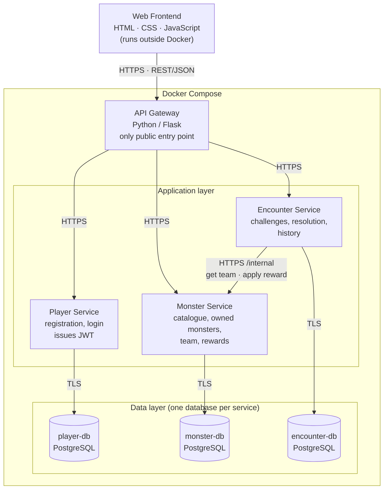

# Monster Tamers architecture

The architecture for the second delivery, with the reason for each choice. It updates slides 3, 9 and 11 of the first-delivery presentation after the professor's feedback ("be careful with the Data Storage Layer to avoid architectural smells", plus the questions on monster power and type modifiers) and the security requirements in §6 of the functional requirements.

Status: written by Hatem, waiting for the team to agree.

## Overview

Only the gateway is published to the host. The three services and the three databases can only be reached inside the Docker network.

## Services

| Service | Owns | Calls |
|---|---|---|
| API Gateway | Routing of public URLs to services | Player, Monster, Encounter |
| Player Service | Accounts and credentials; signs JWTs | Nobody |
| Monster Service | Monster catalogue, owned monsters with their own ATK/HP, current team, applied rewards | Nobody |
| Encounter Service | Challenges, encounter resolution, encounter history | Monster (`/internal` only) |

Calls go one way. The Encounter Service is the only service that calls another one, and it only calls the Monster Service.

## Design rules

### 1. Each service has its own database

Each service gets its own PostgreSQL container, database login and volume. A service can only open its own database. Other services get that data through the owner's REST API.

The first delivery drew one PostgreSQL container shared by all three services, which is the shared-persistence smell the professor warned about. With one admin login, any service could read the passwords table, one leaked password would expose all the data, and one crash would stop every service. With separate containers, the setup itself enforces who owns which data.

### 2. The player's identity comes only from the token

Every service reads the player ID from the verified JWT. No public endpoint accepts a player ID in the URL, the query or the body.

If an endpoint accepted `player_id` from the client, a player could change it and read or modify another player's collection, team or history. This is the most common API vulnerability (broken object-level authorization), and the professor said they will try attacks during the evaluation.

### 3. Service-to-service endpoints are hidden

Calls between services use paths under `/internal/`. The gateway never routes `/internal/` paths, and the Monster Service accepts them only from the Encounter Service, which sends a service credential.

"Grant reward" is the endpoint a cheater would look for first. The requirements say rewards must be updated by the backend services that manage encounter results, never by a client request.

### 4. Encounters are resolved on the server, and each reward is applied once

The client sends only the challenge it wants to face. The Encounter Service reads the team from the Monster Service, computes the win probability, rolls on the server and stores the result. After a win it asks the Monster Service to apply the reward and sends the encounter ID. The Monster Service records each encounter ID and refuses a second reward for the same one.

So the client can never submit an outcome, and a double click or a retry cannot reward twice. If the reward call fails, the encounter keeps `reward_status = pending` and the reward can be retried. The requirements ask us to document how contingencies like this are handled.

### 5. No circular calls

The Player Service calls nobody. The Monster Service creates the starter monsters the first time it sees a new player ID in a valid token.

If Player called Monster at registration and Monster ever called Player, the two services would depend on each other (cyclic-dependency smell), and we could no longer run or test one without the other.

### 6. Only the Player Service can create tokens

The Player Service signs JWTs with a private key that only it holds. The other services verify tokens with the matching public key, which cannot create tokens. Tokens last about 15 minutes and carry the player ID in `sub`, plus `exp`, `iat`, `iss` and `aud`.

With a shared secret, any compromised service could forge a token for any player. Signing with a private key also follows the OAuth2/JWT requirement in §6.

### 7. Every connection is encrypted and nothing else is exposed

The frontend talks to the gateway over HTTPS, and so does the gateway to each service, with self-signed certificates. Services connect to their databases over TLS. No database port is published, and containers run as a non-root user. Passwords and keys come from environment variables or Docker secrets and are never committed; the repository keeps only a `.env.example`.

All of these are explicit requirements in §6. Encrypting traffic inside Docker limits what an attacker learns after taking over one container, and a non-root container has a much harder time attacking the host.

### 8. The gateway is a Flask application

The gateway follows the pattern from Labs 5 and 6: a Flask app that forwards requests and returns 502 or 504 when a service fails or times out. Slide 9 showed an NGINX logo, and the diagram above replaces it.

## Database design

A species is one of the 16 monsters in the catalogue and is the same for every player. An owned monster is one player's copy of a species, with its own ATK and HP. Rewards change the owned monster and leave the species alone.

The player IDs stored in the Monster and Encounter databases are copied from the token. They are not foreign keys, because separate databases cannot reference each other.

### player-db (Player Service)

`player`

| Column | Rule | Why |
|---|---|---|
| `id` | UUID, primary key | Opaque IDs (Lab 3) cannot be guessed the way 1, 2, 3 can |
| `username` | unique, not null | The database rejects duplicates even if two sign-ups arrive at once |
| `password_hash` | not null | bcrypt hash only; a leaked database does not reveal passwords |
| `created_at` | timestamp | Record keeping |

There is no session or token table, because a JWT carries its own expiry. We store no other personal data (email, real name), so there is less to protect.

### monster-db (Monster Service)

`species`: the catalogue, 16 rows loaded once

| Column | Rule | Why |
|---|---|---|
| `id` | primary key | Identifies the monster |
| `name` | unique, not null | |
| `type` | one of `fire`, `water`, `grass`, `dark` | Typos and unknown types are rejected; the names match the monster cards |
| `base_atk`, `base_hp` | integer, greater than 0 | Starting stats from the roster slide; both enter the monster's power (see Encounter rules) |
| `image_url` | not null | Every monster must have an image (requirements §4) |

`owned_monster`: a player's monsters

| Column | Rule | Why |
|---|---|---|
| `id` | UUID, primary key | The team points to this ID |
| `player_id` | UUID, not null | Owner, from the token |
| `species_id` | references `species` | Which monster this is |
| `atk`, `hp` | integer, greater than 0 | Current stats: start at the base values and grow with rewards |
| `source` | `starter` or `capture` | Where it came from (US-06 or US-12) |
| `source_encounter_id` | UUID, unique, nullable | The win that captured it; the same win cannot capture twice |
| `acquired_at` | timestamp | Record keeping |
| | unique (`player_id`, `species_id`) | No duplicates: a player owns at most one of each species |

`team_member`: the three team slots

| Column | Rule | Why |
|---|---|---|
| `player_id`, `slot` | primary key; `slot` is 1, 2 or 3 | At most three slots, one monster per slot |
| `owned_monster_id` | references `owned_monster` together with `player_id` | The database itself rejects a monster the player does not own |
| | unique (`player_id`, `owned_monster_id`) | The same monster cannot fill two slots |

The code that saves the team checks that it has exactly three monsters, and replaces the three slots in one transaction.

`applied_reward`: rewards already given

| Column | Rule | Why |
|---|---|---|
| `encounter_id` | UUID, primary key | A second reward for the same encounter is rejected (rule 4) |
| `player_id` | UUID, not null | Who received it |
| `atk_bonus`, `hp_bonus` | integer | The stat increase applied |
| `captured_species_id` | nullable | The monster captured, if any |
| `applied_at` | timestamp | Record keeping |

### encounter-db (Encounter Service)

`challenge`: encounters a player can choose

| Column | Rule | Why |
|---|---|---|
| `id` | primary key | |
| `name`, `description` | not null | Shown in the challenge list (US-17) |
| `wild_species_id` | not null | The monster faced; its stats are read from the Monster Service at fight time, so the catalogue has a single owner. Challenges differ by this monster's type and stats; there is no separate difficulty level |

`encounter`: one row per fight

| Column | Rule | Why |
|---|---|---|
| `id` | UUID, primary key | Sent with the reward request so the reward is applied once |
| `player_id` | UUID, not null | Whose fight |
| `challenge_id` | references `challenge` | Which challenge |
| `team_snapshot` | JSON, not null | The three monsters with their stats at fight time; history stays correct after rewards change the stats |
| `wild_snapshot` | JSON, not null | The wild monster's stats used in the fight |
| `team_power`, `challenge_power`, `p_win`, `roll` | not null | The full calculation, so any result can be checked; also feeds the result and history pages (US-20, US-24) |
| `result` | `win` or `loss` | |
| `reward_status` | `none`, `pending`, `applied` or `failed` | Shows a reward that still needs to be retried |
| `created_at` | timestamp | |

### Rules for all databases

Each service connects with its own login, which can only reach its own database; no service uses the admin user. Queries use parameters or an ORM and never build SQL by string concatenation, which prevents SQL injection. Each database has its own volume, and no database port is published.

## Encounter rules

We keep the formula agreed in issue #10 and shown on slide 3. Only the monster power changed: it used to be the monster's level (1, 2 or 3), and the 16 monsters now have ATK and HP instead of levels.

1. Monster power = (ATK + HP) / 2. Team monsters use their current stats, and the wild monster uses its base stats.
2. Each team monster's power is adjusted against the wild monster: +1 if its type beats the wild monster's type, -1 if the wild monster's type beats it, 0 otherwise. The adjusted power never goes below 0.
3. Team power = the sum of the three adjusted powers.
4. Challenge power = 3 × the wild monster's power, which puts one monster on the same scale as a team of three.
5. `P(win) = 1 / (1 + exp(-0.6 × (team_power - challenge_power)))`. Equal power gives 50%, a 5-point advantage about 95% and a 5-point disadvantage about 5%.
6. The Encounter Service draws a random number between 0 and 1 with a secure generator, and the player wins if it is lower than P(win).
7. A win increases the ATK and HP of the team monsters and captures the wild monster if the player does not own it yet. A loss gives nothing.

Type cycle: Fire beats Dark, Dark beats Grass, Grass beats Water, Water beats Fire. All other matchups are neutral.

Example: a team of Sproutpaw (Grass, 2/2), Drifin (Water, 2/3) and Emberbun (Fire, 3/2) against a wild Emberbun (Fire, 3/2).

| Monster | Power | Type | Adjusted |
|---|---|---|---|
| Sproutpaw | (2 + 2) / 2 = 2 | neutral | 2 |
| Drifin | (2 + 3) / 2 = 2.5 | Water beats Fire, +1 | 3.5 |
| Emberbun | (3 + 2) / 2 = 2.5 | neutral | 2.5 |

Team power = 8, challenge power = 3 × 2.5 = 7.5, P(win) ≈ 57%.

We use (ATK + HP) / 2 because the requirements ask for at least two characteristics that influence encounters, and this way both stats count equally. The values also stay small like the old levels, so the agreed 0.6 factor still works. With ATK + HP the values double and most fights become certain wins or certain losses. With ATK alone, HP would have no effect.

## Decisions taken

| Decision | Choice |
|---|---|
| Monster power | (ATK + HP) / 2, replacing the level |
| Type names | Fire, Water, Grass, Dark, as on the monster cards |
| Difficulty levels | None; each challenge is one wild monster |
| Database separation | One PostgreSQL container, login and volume per service |
| Capturing a monster the player already owns | No duplicate; the player gets only the ATK/HP reward |
| A separate "progress" table (level, experience) | Not used; progress is the collection, the monsters' stats and the encounter history |
| Gateway owner | Elisa |
| Team endpoints (`GET /team`, `PUT /team`) | Elena, in the Monster Service; team rules from Hatem |

## Still open

- How much a win increases ATK and HP, and whether there is an upper limit.
- The actions for US-21 and US-22 (attack, capture, escape) and how they change the encounter flow.
