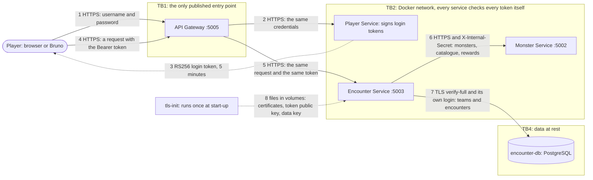

# Threat model: Encounter Service

The Encounter Service as it is on `main` (Lab 11): the threats we found, the control that stops each one, and the test that proves it. `docs/architecture.md` describes the rest of the system.

## 1. Data flow diagram

## 2. Assets, attack surfaces and trust boundaries

### Assets
- **A1, fair results:** the outcome of each encounter (chances, roll, result) and the reward it gives.
- **A2, the players' data:** each player's team and encounter history in encounter-db, including the snapshots of the monsters.
- **A3, secrets:** the encounter-db passwords, `INTERNAL_SERVICE_SECRET`, the data key, and the service's TLS key. The token public key and the CA certificate must not be replaced.
- **A4, availability:** the service answers the players.
- **A5, evidence:** the stored encounters, which say who played what, when, with which result and reward.

### Attack surfaces
- **AS1, the public endpoints** (through the gateway): `GET` and `PUT /team`, `GET /challenges`, `POST /encounters`, `POST /encounters/{id}/action`, `GET /encounters`, `GET /encounters/{id}`.
- **AS2, the Monster Service's answers:** the service trusts them for the monsters a player owns and their stats.
- **AS3, encounter-db** on the Docker network (port 5432, not published).
- **AS4, the supply chain:** the libraries, the base images, the repository and the CI pipeline.
- **AS5, the component-test setup:** `compose.encounter.yaml` publishes port 5003 and the two stubs, only on `127.0.0.1` and only for tests.

### Trust boundaries
- **TB1, the internet and our system:** only the gateway is published, over HTTPS.
- **TB2, the gateway and the Encounter Service:** the service does not rely on the gateway. It checks every token itself: the signature, RS256 only, `exp`, `iss`, `aud`, and `sub`.
- **TB3, the Encounter Service and the Monster Service:** HTTPS with certificates from our own authority, and `X-Internal-Secret` on the `/internal` calls.
- **TB4, the Encounter Service and encounter-db:** TLS with `verify-full`, a login that can only reach this database, and the snapshots encrypted.
- **TB5, the build and the running system:** secrets are made at start-up by tls-init and `.env`, never committed or put in an image. CI scans the code, the libraries, the images and the repository.

## 3. STRIDE threats

| # | STRIDE | Where | Threat | Control | Test | Status |
|---|---|---|---|---|---|---|
| 1 | S | Arrows 4, 5 | Someone calls the API as another player with no token or a forged one: no signature (`alg: none`), another key, or HS256 with the public key as the secret. | Every token is checked by the service: RS256 only, signature, `exp`, `iss`, `aud`, `sub` required. A 401 carries `WWW-Authenticate: Bearer` (Lab 10). | `tests/test_team.py`: `test_an_unsigned_token_is_refused`, `test_a_token_signed_with_the_public_key_as_a_shared_secret_is_refused`, `test_a_token_not_signed_by_the_player_service_is_refused`. Bruno `encounter/03`, `04`, `encounter-security/12`, `13` | Covered |
| 2 | S | Arrow 6 | A fake Monster Service inside the network answers the Encounter Service, for example to say that a player owns very strong monsters. | HTTPS with certificates from our authority; any other certificate is refused (Lab 8). | `tests/test_tls.py::test_a_server_with_a_certificate_from_another_authority_is_refused` | Covered |
| 3 | T | Arrows 4, 5 | A player sends the result, the roll or the reward instead of letting the server decide. | The client sends only the challenge and the action. The server computes the chances from the Monster Service's stats and rolls with the secure generator (design rule 4). | `tests/test_action.py`: `test_an_attack_that_wins_raises_the_team_stats`, `test_an_attack_that_loses_gives_nothing`. `tests/test_rules.py` | Covered |
| 4 | T | Arrows 4, 5 | Hostile input: a huge body, `NaN`, `1e999`, control characters, very long IDs. | A 10 KB limit, whole numbers in range, printable IDs of at most 64 characters. Bad input is refused, never cleaned (Lab 8). | `tests/test_hostile_input.py`. Bruno `encounter-security/02` to `11` | Covered |
| 5 | T | Arrows 5, 6 | A double click or a retry plays one encounter twice and doubles the reward. | One conditional update closes the encounter; the Monster Service records each encounter ID (design rule 4). | `tests/test_race.py::test_a_second_click_while_the_first_is_being_rewarded_gets_nothing`, `tests/test_action.py::test_a_finished_encounter_cannot_be_played_again`. Bruno `encounter/20` | Covered |
| 6 | T | Arrow 6 | A player ID with special characters changes which Monster Service address is called. | The player ID is encoded before it goes into the URL. | `tests/test_http_monster_client.py::test_a_player_id_cannot_change_which_address_is_called` | Covered |
| 7 | T | Arrow 7 | Someone with access to the database changes a stored snapshot. | Fernet is authenticated encryption: a changed value cannot be decrypted (Lab 8). | none yet | Partial |
| 8 | R | Encounter Service | A player says they never played an encounter, or that a reward was never given. | Every encounter is stored with its player, `created_at`, `closed_at`, the action, the roll, the result and `reward_status`. | `tests/test_history.py::test_every_encounter_answer_says_when_it_opened_and_when_it_ended`, `tests/test_action.py::test_a_reward_the_monster_service_refuses_is_marked_failed_and_never_retried` | Covered |
| 9 | R | Arrows 4, 5 | Refused requests (401, 404, 409) leave no record, so nobody can see who tried what. | none in this service | none | GAP |
| 10 | I | Arrows 4, 5 | A player reads another player's team or encounters. | The player ID comes only from the token. Another player's encounter answers 404, like one that does not exist (design rule 2). | `tests/test_team.py::test_a_player_only_sees_their_own_team`, `tests/test_history.py::test_another_players_encounter_and_an_unknown_one_look_the_same`. Bruno `encounter/26` | Covered |
| 11 | I | Arrow 7 | A copy of the database or of a backup shows the players' monsters. | The team and wild snapshots are encrypted with Fernet. The key is in the service's own volume, never in the database (Lab 8). | `tests/test_encryption_at_rest.py`, `tests/test_tls.py::test_only_the_encounter_service_gets_a_data_key_and_a_restart_keeps_it` | Covered |
| 12 | I | Arrows 5, 6, 7 | Someone on the Docker network reads the traffic. | HTTPS between services; TLS with `verify-full` to the database, which accepts only TLS connections (Lab 8). | `tests/test_tls.py`; CI runs the Bruno tests over HTTPS with our CA | Partial |
| 13 | I | Build and run | A key or a password is committed, or a library or an image has a known vulnerability. | Secrets are made at start-up and never committed. CI runs Bandit, pip-audit, and trivy on the images, the Dockerfiles and the repository (Lab 9). | `.github/workflows/ci.yml`, jobs `security`, `images`, `secrets` | Covered |
| 14 | I | Arrows 4, 5 | An error answer shows internal details such as a stack trace or SQL. | Every error, including a crash, becomes `{"error", "message"}`. | `tests/test_errors.py` | Covered |
| 15 | D | Arrows 4, 5 | A script opens encounters or calls the API thousands of times a second. | A player can open at most 10 encounters a minute; the 11th gets 429 `too_many_requests`, before any call to the Monster Service. The count comes from encounter-db, so it holds for every worker. | `tests/test_rate_limit.py`: `test_the_eleventh_encounter_within_a_minute_is_refused`, `test_after_a_minute_the_player_can_open_encounters_again` | Covered (top gap, closed) |
| 16 | D | Arrow 6 | A slow or stopped Monster Service blocks the Encounter Service. | A 3-second timeout, then 502 or 504. A won reward waits as `pending` and is sent again before the next encounter. | `tests/test_open_encounter.py::test_opening_an_encounter_while_the_monster_service_is_too_slow_times_out`, `tests/test_action.py::test_a_win_is_kept_and_its_reward_waits_when_the_monster_service_is_down`. Bruno `encounter-stub/12`, `13` | Covered |
| 17 | E | Arrows 4, 5, 6 | A player plays someone else's encounter, or puts someone else's monsters in their team. | Authorization by ownership: the team and the encounters belong to the player in the token, and the Monster Service confirms which monsters the player owns. There are no roles, because the requirements only have players. | `tests/test_action.py::test_a_player_cannot_play_someone_elses_encounter`, `tests/test_team.py::test_a_player_cannot_put_someone_elses_monster_in_their_team`. Bruno `encounter/08`, `17` | Covered |
| 18 | E | Arrows 4, 5 | A stolen token is used until it expires. | Tokens last 5 minutes and `exp` is always checked (Lab 10). They cannot be revoked. | `tests/test_team.py::test_an_expired_token_is_refused`. Bruno `encounter-security/15` | Partial |

## 4. Ratings and decisions

| # | Likelihood | Impact | Why | Decision |
|---|---|---|---|---|
| 7 | Low | Medium | It needs access to the database first, and the snapshot only describes the monsters. | Add a test: a changed snapshot is refused, never served. |
| 9 | High | Medium | Attacks start with refused requests, and today nothing records them. | Lab 11 puts the audit log at the entry points, the gateway and the login, not in the services behind them. This service's own evidence is row 8. |
| 12 | Low | Medium | It needs a foothold inside the Docker network. The database already refuses connections without TLS (`hostssl` in `pg_hba.conf`). | Accept: the database enforces TLS itself; no separate test. |
| 15 | Medium | Medium | Anyone with an account and a script can do it. It slows the service and fills the encounter table, but no data is lost. | Closed, as the top gap of Lab 11: the limit of 10 encounters a minute (row 15). Remaining risk: the limit is per player, so a script with many accounts gets further, and the read-only endpoints have no limit. A limit for every request belongs at the gateway, the entry point. |
| 18 | Low | Medium | A token has to be stolen first (TLS protects it in transit), and it works for 5 minutes at most. | Accept: short tokens limit the damage; a revocation list is not needed for this project. |
