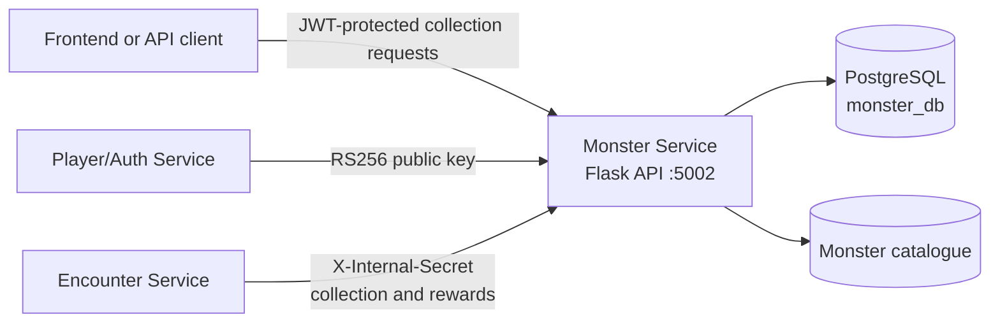

# Monster Service

## Architecture diagram



The Monster Service owns the monster catalogue and each player's collection.
The Player/Auth Service issues JWTs, while the Encounter Service uses the
internal service secret to read collections and apply encounter rewards.

For more see docs/architecture.md and architecture

## OpenAPI specifications

The complete API contract is available in
[`openapi.yaml`](./openapi.yaml). It is an OpenAPI 3.0 specification covering:

- the public catalogue and monster image endpoints;
- the JWT-protected player collection endpoint;
- the internal collection endpoint used by the Encounter Service;
- the internal stats and capture reward endpoint;
- the service health check.

The specification can be imported into Swagger UI, Postman, Bruno, or another
OpenAPI-compatible tool.

## Implementation status

Implemented:

- 16-monster catalogue with idempotent startup seeding;
- player collection creation with three starter monsters;
- collection and catalogue HTTP endpoints;
- monster artwork serving;
- RS256 JWT validation for player requests;
- shared-secret validation for internal service requests;
- capture rewards and capped stat rewards;
- idempotent reward application through the `AppliedReward` table;
- PostgreSQL deployment through Docker Compose;
- automated pytest coverage and Bruno request collections.

The service does not issue JWTs and does not own player authentication.

## Running instructions

### Docker Compose

From the `monster_service` directory, ensure the required files exist under
`certs/` (`ca.pem`, `server.pem`, `server.key`, `db_password.txt`,
`data_key.txt`, `jwt_private.pem`, and `jwt_public.pem`), then run:

```bash
docker compose -f docker-compose.yaml up --build
```

The API is available at `https://localhost:5002`. Because the local
certificate is self-signed, use `-k` with curl:

```bash
curl -k https://localhost:5002/health
curl -k https://localhost:5002/monsters
```

Set `INTERNAL_SERVICE_SECRET` in the environment to override the local
development default. The collection endpoint requires a valid JWT issued by
the Player/Auth Service; internal endpoints require the
`X-Internal-Secret` header.

### Local Python process

```bash
python -m venv .venv
# Linux/macOS:
source .venv/bin/activate
# Windows PowerShell:
.venv\Scripts\Activate.ps1

pip install -r requirements.txt
flask --app "app:create_app()" run --port 5002
```

Set `JWT_PUBLIC_KEY` (or `JWT_PUBLIC_KEY_PATH`) and
`INTERNAL_SERVICE_SECRET` before starting the application. A reachable
PostgreSQL database is also required.

## Testing instructions

The automated tests use an in-memory SQLite database and generate a temporary
RS256 key pair, so PostgreSQL and Docker are not required:

```bash
pytest
```

To run only the Monster Service tests from the repository root:

```bash
pytest monster_service/tests -q
```

The `tests/bruno` collection provides additional request-level checks for
catalogue, collection, and reward workflows. Configure the local Bruno
environment with the service URL and the internal secret before running those
requests.

## Additional information

- Public catalogue routes do not require authentication.
- `/collection` requires `Authorization: Bearer <JWT>`.
- Internal routes require `X-Internal-Secret` and must not be called by the
  frontend.
- Reward requests are keyed by `encounter_id`; retrying an already applied
  reward is safe and does not apply it twice.
- Player-owned monsters cannot contain the same catalogue species more than
  once.
- For production, provide database credentials, JWT keys, certificates, and
  internal secrets through deployment secrets rather than source-controlled
  files.

The `monster_service` directory contains the Monster Service microservice of the
ASE project. It is a Flask application that owns the global monster catalogue,
creates and stores each player's collection, serves monster artwork, and
receives rewards from the Encounter Service.

The service exposes a JSON HTTP API and persists its data with SQLAlchemy. In a
containerized deployment it listens on port `5002` over HTTPS and connects to
PostgreSQL.

## Responsibilities

The service is responsible for:

- maintaining the catalogue of 16 monsters;
- returning catalogue entries and individual monster details;
- lazily assigning three starter monsters to a player on the first collection
  request;
- storing player-specific attack (`atk`) and health (`hp`) values;
- exposing an internal collection endpoint for other services;
- applying encounter rewards:
  - stat bonuses to one or more owned monsters; or
  - a newly captured catalogue species;
- making monster image assets available through HTTP;
- validating user JWTs and internal service-to-service requests.

The service does not issue JWTs. Tokens are issued by the Player/Auth Service
and verified here with its configured RSA public key.

## Directory structure

```text
monster_service/
├── app/
│   ├── __init__.py              # Flask application factory and service setup
│   ├── auth.py                  # JWT and internal-secret decorators
│   ├── initial_monsters.py      # Catalogue seed data and starter IDs
│   ├── models.py                # SQLAlchemy models and serializers
│   ├── routes/
│   │   └── monsters.py          # Catalogue, collection and reward routes
│   └── static/
│       └── assets/monsters/     # Monster artwork
├── tests/
│   ├── test_monsters.py         # Flask integration tests
│   └── bruno/                   # Bruno API request collection
├── docker-compose.yaml          # Docker Compose definition
├── Dockerfile                   # Production container image
├── openapi.yaml                 # OpenAPI 3.0 API description
└── requirements.txt             # Python dependencies
```

## Application startup

The application is created through the `create_app()` factory in
`app/__init__.py`. Startup performs the following operations:

1. Creates a Flask application.
2. Builds the PostgreSQL connection using the `monster_db` host and the
   `db_password` Docker secret (or the default local password).
3. Initializes Flask-SQLAlchemy.
4. Registers the monster blueprint.
5. Creates database tables if they do not already exist.
6. Seeds the catalogue when the `monster_catalog` table is empty.

The catalogue seed is idempotent: existing catalogue rows are not duplicated.
The default starter species are:

| Catalogue ID | Name | Element | Power | HP |
|---:|---|---|---:|---:|
| 1 | Sproutpaw | Grass | 2 | 2 |
| 5 | Drifin | Water | 2 | 3 |
| 9 | Emberbun | Fire | 3 | 2 |

## Data model

### `MonsterCatalog`

Represents a global species in the catalogue:

- `id`: integer catalogue identifier;
- `name`: unique species name;
- `element`: `Fire`, `Water`, `Dark`, or `Grass`;
- `power`: base attack value;
- `hp`: base health value;
- `image_url`: public path for the species artwork.

### `PlayerMonster`

Represents one monster owned by a player:

- `id`: ownership identifier returned as `ownership_id`;
- `player_id`: identifier of the owning player;
- `monster_id`: foreign key to `MonsterCatalog`;
- `atk` and `hp`: player-specific values;
- `acquired_at`: UTC acquisition timestamp;

The database prevents a player from owning the same species more than once.

### `AppliedReward`

Records each encounter whose reward has been applied. The encounter ID is the
primary key, so retrying the same reward request is idempotent.

## API

The complete machine-readable contract is in [`openapi.yaml`](./openapi.yaml).
Unless stated otherwise, successful responses use `application/json`.

### Health check

```http
GET /health
```

Returns the service status and service name.

### Catalogue

```http
GET /monsters
GET /monsters/{monster_id}
```

`GET /monsters` returns all 16 catalogue entries ordered by ID.
`GET /monsters/{monster_id}` returns one entry. Valid IDs are `1` through `16`;
invalid or unknown IDs return `404`.

Example catalogue entry:

```json
{
  "id": 9,
  "name": "Emberbun",
  "element": "Fire",
  "power": 3,
  "hp": 2,
  "image_url": "/assets/monsters/emberbun.png"
}
```

### Monster images

```http
GET /assets/monsters/{filename}
```

Serves files from `app/static/assets/monsters`. The same asset path is
available for catalogue `image_url` values.

### Player collection

```http
GET /collection
Authorization: Bearer <JWT>
```

The JWT must contain a `sub` or `player_id` claim. If the player has no
collection yet, the service lazily creates the three starter monsters.

Response shape:

```json
{
  "player_id": "player_123",
  "count": 3,
  "collection": [
    {
      "ownership_id": 1,
      "player_id": "player_123",
      "acquired_at": "2026-11-05T18:00:00+00:00",
      "atk": 2,
      "hp": 2,
      "monster": {
        "id": 1,
        "name": "Sproutpaw",
        "element": "Grass",
        "power": 2,
        "hp": 2,
        "image_url": "/assets/monsters/sproutpaw.png"
      }
    }
  ]
}
```

Missing, expired, malformed, or invalid JWTs return `401`.

### Internal player collection

```http
GET /internal/players/{player_id}/monsters
Authorization: Bearer <JWT>
```

This endpoint is intended for trusted services and returns the player's
collection:

```http
X-Internal-Secret: <shared-secret>
```

This endpoint is intended for trusted services. It returns the player's
collection:

```json
{
  "player_id": "player_123",
  "count": 3,
  "collection": []
}
```

Requests without the configured internal secret return `403`.

### Internal rewards

```http
POST /internal/rewards
X-Internal-Secret: <shared-secret>
Content-Type: application/json
```

The request must contain `player_id` and a unique `encounter_id`. It must
specify exactly one of the following reward types.

#### Capture reward

Adds a new species to the player's collection:

```json
{
  "player_id": "player_123",
  "encounter_id": "enc_987654",
  "captured_species_id": 11
}
```

The species must exist and must not already be owned. A successful capture
returns `201`. Repeating the same `encounter_id` returns `200` without adding a
duplicate reward.

#### Stats reward

Increases the selected owned monsters' stats:

```json
{
  "player_id": "player_123",
  "encounter_id": "enc_987655",
  "owned_monster_ids": [1, 2],
  "atk_bonus": 1,
  "hp_bonus": 2
}
```

Bonuses must be non-negative integers. Each value is capped at three points
above the corresponding catalogue value. A successful stats reward returns
`200`.

Both reward types reject malformed payloads with `400`. Unknown species or
foreign ownership IDs return `404`; duplicate species ownership or database
conflicts return `409`.

## Authentication and configuration

The service supports two authentication mechanisms:

1. **Player JWTs** use RS256 and are required for `/collection`.
2. **Internal service secrets** use the `X-Internal-Secret` header and are
   required for internal collection and reward routes.

Supported environment variables:

| Variable | Purpose |
|---|---|
| `DATABASE_URL` | Reserved for future configuration; currently ignored by the application |
| `JWT_PUBLIC_KEY` | PEM-encoded RSA public key; escaped `\n` sequences are expanded |
| `JWT_PUBLIC_KEY_PATH` | File containing the public key; default `/certs/jwt_public.pem` |
| `INTERNAL_SERVICE_SECRET` | Shared secret for internal endpoints |

For production, provide secrets through the deployment environment or a secret
manager rather than committing them to source control.

## Running with Docker Compose

From this directory:

```bash
docker compose -f docker-compose.yaml up --build
```

The Compose file starts:

- `monster_service`, exposed on `127.0.0.1:5002`;
- `monster_db`, a PostgreSQL 15 instance on `127.0.0.1:5432`.

The container listens on port `5002` with Flask's HTTPS development server. The
certificate and key are mounted as Docker secrets; the image does not generate
them automatically. The Compose configuration uses the service name
`monster_db` to connect to PostgreSQL.

The Compose file expects these files to exist before startup:

```text
certs/ca.pem
certs/server.pem
certs/server.key
certs/db_password.txt
certs/data_key.txt
```

The database password is read from `certs/db_password.txt`. `DATABASE_URL` is
currently not used by the application, so changing that variable alone does
not change the database connection.

To check the service after startup:

```bash
curl -k https://localhost:5002/health
curl -k https://localhost:5002/monsters
```

The `-k` option is needed for the repository's self-signed certificate. A
browser or frontend must either trust the configured CA certificate or use the
gateway that terminates/proxies HTTPS.

The public catalogue and image routes do not require a token. The collection
route requires a JWT issued by the Player/Auth Service, while the
`/internal/*` routes are for service-to-service calls only and require
`X-Internal-Secret`. The frontend should not call the internal routes or send
the internal secret.

To build and run only this service, use the Compose file from this directory:

```bash
docker compose -f docker-compose.yaml up --build
```

Running only `docker build` followed by `docker run` is not sufficient unless
the PostgreSQL database, HTTPS certificate/key, JWT public key, and internal
secret are provided separately. The recommended standalone setup is therefore
the provided Compose file.

## Running locally

Create and activate a Python virtual environment, then install dependencies:

```bash
python -m venv .venv
# Linux/macOS:
source .venv/bin/activate
# Windows PowerShell:
.venv\Scripts\Activate.ps1

pip install -r requirements.txt
```

Set `JWT_PUBLIC_KEY` (or `JWT_PUBLIC_KEY_PATH`) and
`INTERNAL_SERVICE_SECRET`. For a local PostgreSQL instance, the current
application expects a database reachable as `monster_db`; the Docker Compose
configuration supplies this hostname automatically. Then start Flask through
the application factory:

```bash
flask --app "app:create_app()" run --port 5002
```

For a local process using HTTP:

```bash
flask --app "app:create_app()" run --host 0.0.0.0 --port 5002
```

For HTTPS outside Docker, provide the certificate and key explicitly:

```bash
flask --app "app:create_app()" run --host 0.0.0.0 --port 5002 \
  --cert path/to/server.pem --key path/to/server.key
```

## Testing

The Python tests use an in-memory SQLite database and generate a temporary
RS256 key pair, so they do not require a running PostgreSQL container:

```bash
pytest
```

The test suite covers catalogue retrieval, image routes, JWT failures, lazy
starter initialization, internal-secret protection, capture
rewards, idempotency, and capped stat rewards.

The `tests/bruno` collection provides additional request-level checks for the
catalogue, collection, and reward workflows.

## API documentation

`openapi.yaml` contains the OpenAPI 3.0 definition for the public catalogue,
collection, and internal reward operations. It can be imported into Swagger
UI, Postman, Bruno, or another OpenAPI-compatible tool for interactive
testing.
