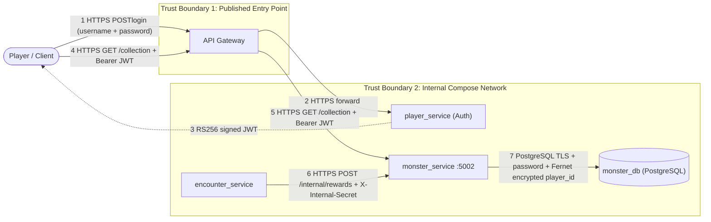

# Threat Model — Monster Service (ASE Project)

## 1. Data Flow Diagram (DFD)

## 2. Assets, Attack Surfaces, and Trust Boundaries

### Assets
* **A1 — Player Collection & Monster Stats**: Ownership and stat bonuses of captured monsters (`player_monsters` table).
* **A2 — Player Identity at Rest (`player_id`)**: Encrypted via Fernet (`DATA_KEY`) inside `monster_db` to preserve confidentiality at rest.
* **A3 — Master Catalog Integrity**: The 16 base species and their elemental/combat attributes (`monsters` table).
* **A4 — Cryptographic & Service Secrets**: `JWT_PUBLIC_KEY` (`jwt_public.pem`), `INTERNAL_SERVICE_SECRET`, `DATA_KEY` (`data_key.txt`), database password (`db_password.txt`), and TLS private key (`server.key`).
* **A5 — Service Availability**: Ability of `monster_service` to serve catalog and collection queries without disruption.
* **A6 — Audit Evidence**: Non-repudiable JSON audit logs recording who performed or attempted each action and its outcome.

### Attack Surfaces
* **AS1 — Public/Player REST Endpoints**: `GET /monsters`, `GET /monsters/<id>`, `GET /assets/monsters/<filename>`, `GET /collection`.
* **AS2 — Internal Service Endpoints**: `POST /internal/rewards`, `GET /internal/players/<id>/monsters`.
* **AS3 — Database Connection**: PostgreSQL port `5432` exposed on the internal Docker network.
* **AS4 — Supply Chain & Container Image**: Python packages (`requirements.txt`), base Docker image, and GitHub Actions CI pipeline.

### Trust Boundaries
* **TB1 — External Client | API Gateway / Published Port**: Untrusted internet traffic enters the system over HTTPS.
* **TB2 — Gateway & Peer Microservices | `monster_service`**: Requests cross into `monster_service` carrying either an RS256 user JWT or an `X-Internal-Secret` header.
* **TB3 — `monster_service` Process | `monster_db` Data Store**: Application process reads/writes persistent state and decrypts/encrypts sensitive columns.
* **TB4 — Git Repository & CI Pipeline | Running Containers**: Build-time code and secrets mounted at runtime via Docker secrets/volumes.

---

## 3. STRIDE Threat Table

| # | STRIDE | Where | Threat | Control (Lab) | Test | Status |
|---|---|---|---|---|---|---|
| 1 | **S** | Arrow 4/5 (`GET /collection`) | An attacker connects without a token or with an unverified token to impersonate a player. | RS256 signature and required `exp`, `iss`, `sub`, and `aud` claims via `require_jwt` (Lab 10) | `tests/test_monsters.py::test_collection_missing_token` & Bruno collection auth cases | Covered |
| 2 | **S** | Arrow 6 (`POST /internal/rewards`) | An external caller or unauthorized container impersonates `encounter_service` to grant free monsters. | Shared secret verification via `require_internal_secret` (`X-Internal-Secret`) (Lab 10) | `tests/test_monsters.py::test_grant_reward_invalid_inputs` | Covered |
| 3 | **T** | Arrow 4/5 (`GET /collection`) | An attacker modifies the JWT header to `alg: none` or tampers with `sub` to access another player's collection. | Explicit `algorithms=["RS256"]` enforcement in `PyJWT` (Lab 10) | `tests/test_monsters.py::test_collection_forged_alg_none` & Bruno `05-collection-forged-token.bru` | Covered |
| 4 | **T** | Arrow 6 (`POST /internal/rewards`) | Hostile input (`NaN`, `1e999`, control characters, negative IDs) corrupts monster ownership or crashes the worker. | Strict JSON parsing, integer type validation, and species existence checks (Lab 8) | Bruno `Security/Grant Reward 1e999`, `NaN`, `s.c.` & `test_grant_reward_invalid_inputs` | Covered |
| 5 | **T** | Arrow 6 (`POST /internal/rewards`) | Network retry replays the same reward request twice, duplicating monster rewards or stat boosts. | Idempotency tracking via `encounter_id` (`RewardTransaction` table) (Lab 8) | `tests/test_monsters.py::test_grant_reward_valid_and_idempotent` | Covered |
| 6 | **R** | `monster_service` process | A player or internal caller triggers unauthorized requests or reward grants and denies it; no structured trail exists. | Structured single-line JSON audit log on every request via `@app.after_request` (`app/audit.py`) (Lab 11) | `tests/test_monsters.py::test_audit_log_records_denied_and_success` & `test_audit_log_no_newline_injection` | Covered (Gap fixed) |
| 7 | **I** | `monster_db` data store | An attacker who obtains a database dump reads plain-text player associations (`player_id`). | Fernet encryption of player IDs with a persistent service key and a keyed HMAC lookup index | `tests/test_monsters.py::test_get_collection_lazy_init_valid` and legacy-data migration test | Covered |
| 8 | **I** | Arrow 4/5/6 and service-to-database traffic | An eavesdropper captures a Bearer JWT, internal secret, or database credentials. | HTTPS for the API, PostgreSQL TLS with certificate verification, and Bruno CA verification | CI Bruno component run and PostgreSQL TLS connection settings | Covered |
| 9 | **I** | Repository & Container Image | A developer accidentally commits a private key or ships a vulnerable library/base image. | Bandit, `pip-audit`, and Trivy image/config/secret scans in GitHub Actions (Lab 9) | `.github/workflows/` (`security` and `images` jobs) | Covered |
| 10 | **D** | Arrow 1/4/5 (`monster_service`) | A script floods `/monsters` or `/collection` with thousands of requests per second, exhausting Gunicorn workers. | none | none | GAP |
| 11 | **E** | Arrow 4/5 (`GET /collection`) | An attacker replays an old leaked JWT hours later to keep accessing the victim's collection. | Expiration timestamp (`exp`) enforced on every JWT decode (Lab 10) | `tests/test_monsters.py::test_collection_expired_token` & Bruno `06-collection-expired-token.bru` | Partial |
| 12 | **E** | Arrow 6 (`/internal/*`) | A compromised service inside the Docker network reads `X-Internal-Secret` or calls internal routes without mTLS client cert verification. | `X-Internal-Secret` header check, but no per-caller mTLS identity check enforced in Python | `tests/test_monsters.py::test_grant_reward_invalid_inputs` | Partial |

---

## 4. Gap & Partial Risk Ratings and Decisions

| Row | Threat Summary | Likelihood | Impact | Rating & Reason (1 line) | Decision & Next Step |
|---|---|---|---|---|---|
| **#6 (R)** | No audit trail of who called `/collection` or `/internal/rewards` and with what outcome. | **High** | **Medium** | Anyone can send requests today, and without logs we cannot detect attacks or settle disputes. | **Mitigated (Fixed in Lab 11)**: Added `app/audit.py` + `@app.after_request` hook + `caplog` tests. *Residual risk*: Someone with root access to the host can alter container stdout logs; forward logs to an append-only collector in production. |
| **#10 (D)** | Script floods `/monsters` or `/collection` (no rate limiting). | **High** | **Medium** | Anyone with a script can slow down or block the service temporarily, though no data is lost. | **Mitigated**: The Gateway limits each source IP to 30 requests per minute independently on `/monsters` and `/collection`, using shared Redis storage and returning `429 Too Many Requests`. |
| **#11 (E)** | Stolen JWT remains usable until its `exp` timestamp expires. | **Low** | **Medium** | Requires stealing a token first (TLS protects transit), and impact is limited to one player's collection during the token lifetime. | **Accept and document**: Short token lifetime limits the window; revisit if token revocation lists (denylist) become necessary. |
| **#12 (E)** | Internal endpoints rely on a shared `X-Internal-Secret` rather than per-service mTLS client certificates. | **Low** | **High** | Requires an attacker to already have a foothold inside the internal Compose network and leak the secret. | **Accept for current scope**: Shared secret is active and tested; upgrade to strict mTLS client verification when moving to production. |